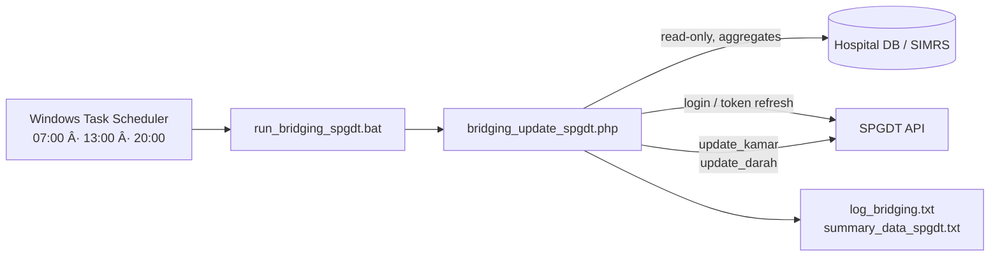

# SPGDT Bridging Kebumen Regency

[](https://github.com/ArkFunDev/spgdt-bridging-kebumen/actions/workflows/php-lint.yml)
[](LICENSE)
[](https://www.php.net/)
[](#why-it-matters)

Automated service that pushes **hospital bed availability** and **blood stock** from a hospital information system (SIMRS) database to the regional emergency-care platform **SPGDT** (*Sistem Penanggulangan Gawat Darurat Terpadu*, Integrated Emergency Response System) of Kebumen Regency, Central Java, Indonesia. It runs three times a day with no manual data entry.

It is a small, dependency-free PHP tool that reads **aggregate counts only**, handles authentication and token renewal, retries failed requests, prevents overlapping runs, and rotates its own logs. **No patient-identifiable data is ever read, stored, or transmitted.**

Built and operated in a real hospital environment.

## Why it matters

Ambulance crews and emergency dispatchers need to know **which hospital still has a free ICU bed or a particular blood type** before referring a patient. Manually maintained data goes stale quickly. This tool keeps it current, automatically and safely.

## How it works



## Features

- **Two datasets:** beds (VVIP, VIP, Class 13, ICU, ICCU, perinatal, delivery room, isolation, ER, ventilators) and blood stock (A, B, AB, O).
- **Automatic token management:** the token is renewed monthly, and renewed and retried automatically if the API rejects it (HTTP 401/403).
- **No overlapping runs:** a `flock`-based lock file stops two instances from overwriting each other.
- **Capacity validation:** reported occupancy never exceeds the hospital's official capacity, and over-capacity events are logged.
- **Fail-safe by design:** if a database query fails, the upload is cancelled. The tool never sends zeros that would overwrite valid data on the platform.
- **Observability:** per-run session IDs in logs, a readable summary table for every upload, automatic rotation (logs at 2 MB, summaries at 5 MB), and meaningful exit codes for monitoring.
- **No dependencies:** PHP with the `curl` and `mysqli` extensions only.

## Privacy and security

| Area | Approach |
|---|---|
| Patient data | **Never read or transmitted.** Only aggregate `COUNT` / `SUM` queries. |
| Credentials | Kept in `config.php` (git-ignored), never in source code. Template: `config.example.php`. |
| Database account | A **read-only** (`SELECT`) account is sufficient. |
| TLS | Certificate verification is **on by default**; a `ca_bundle` option supports Windows/XAMPP setups. |
| SQL | Queries with dynamic values use prepared statements. |
| Token | Stored in `token_spgdt.json` (git-ignored; mode 0600 where the OS supports it). |
| Logs | Passwords and tokens are never logged. |

Please report security issues privately (see Contact) before opening a public issue.

## Requirements

- PHP **8.0+** with the `curl` and `mysqli` (mysqlnd) extensions
- Network access to the SPGDT API and the hospital database
- Windows (Task Scheduler) or Linux (cron)

The expected database schema follows SIMRS Khanza conventions: tables `kamar` (rooms), `reg_periksa` (registrations), `catatan_observasi_ventilator` (ventilator observations) and `utd_stok_darah` (blood bank stock). Adjust the queries in `bridging_update_spgdt.php` if your schema differs.

## Installation

```bat
git clone https://github.com/ArkFunDev/spgdt-bridging-kebumen.git C:\spgdt
cd C:\spgdt
copy config.example.php config.php
notepad config.php
```

Fill in `config.php` (API URL, credentials, database, official bed capacities), then test manually:

```bat
C:\xampp\php\php.exe -f bridging_update_spgdt.php
```

### Scheduling on Windows

Import the task template, then adjust the path in the *Actions* tab if the repo is not in `C:\spgdt`:

```bat
schtasks /Create /TN "Bridging SPGDT Auto Update" /XML Bridging_SPGDT_Auto_Update.xml /RU <USER> /RP *
```

If PHP is not at `C:\xampp\php\php.exe`, set the `PHP_BIN` environment variable.

### Scheduling on Linux (cron)

```cron
0 7,13,20 * * * /usr/bin/php /opt/spgdt/bridging_update_spgdt.php >> /var/log/spgdt-cron.log 2>&1
```

## Configuration

| Key | Description |
|---|---|
| `api.base_url` | SPGDT API base URL, ending with `/` |
| `api.username` / `api.password` | API credentials |
| `api.verify_ssl` / `api.ca_bundle` | TLS verification and optional CA bundle path |
| `db.*` | Database host, port, user, password, name |
| `capacity.*` | Official bed capacity per category |
| `debug` | Show PHP errors in the console (debugging only) |

The config path can be overridden with the `SPGDT_CONFIG` environment variable.

## Exit codes

| Code | Meaning |
|---|---|
| 0 | All uploads succeeded |
| 1 | One or more uploads failed |
| 2 | Another instance is still running |
| 3 | Configuration missing or invalid |
| 4 | API authentication failed |
| 5 | Database connection failed |

## Repository layout

```
.
├── bridging_update_spgdt.php        # main script
├── config.example.php               # configuration template (copy to config.php)
├── run_bridging_spgdt.bat           # launcher for Task Scheduler
├── Bridging_SPGDT_Auto_Update.xml   # Windows scheduled-task template
├── .gitignore  .gitattributes  LICENSE
```

Note: log messages and code comments are currently in Indonesian, the working language of the deployment.

## Roadmap

- Alerts (email/Telegram) after consecutive failed runs
- Automated tests with a mock API and test database
- Multi-hospital support through multiple config files
- `--dry-run` mode to inspect the payload without sending it
- English log messages via a language option

## License

[MIT](LICENSE). Free to reuse and adapt for other healthcare facilities.

## Contact

[YOUR NAME] · [email or GitHub/LinkedIn profile]
