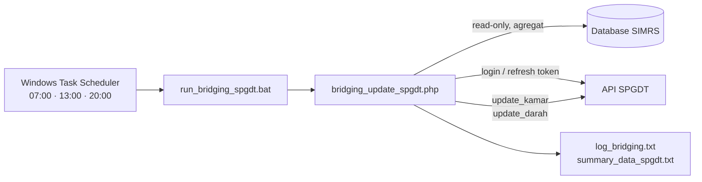

# SPGDT Bridging – Kabupaten Kebumen

Otomasi pengiriman **ketersediaan tempat tidur** dan **stok darah** dari database SIMRS rumah sakit ke platform **SPGDT** (Sistem Penanggulangan Gawat Darurat Terpadu) Kabupaten Kebumen, tiga kali sehari tanpa input manual.

> 🇬🇧 **In short:** a small, dependency-free PHP service that reads *aggregate* bed-occupancy and blood-stock counts from a hospital information system (SIMRS) database and pushes them to a regional emergency-care API (SPGDT) on a schedule. It handles authentication, token renewal, retries, overlapping runs, and log rotation. No patient-identifiable data is ever read, stored, or transmitted.

Dibuat dan dioperasikan di lingkungan rumah sakit nyata sebagai bagian dari upaya menjaga informasi kapasitas gawat darurat tetap akurat bagi petugas rujukan.

## Mengapa penting

Petugas ambulans dan call center gawat darurat perlu tahu **rumah sakit mana yang masih punya ICU kosong atau stok darah golongan tertentu** sebelum merujuk pasien. Data yang diperbarui manual cepat basi. Skrip ini menjaga data tersebut mutakhir secara otomatis dan aman.

## Alur kerja



## Fitur

- **Dua dataset:** kamar (VVIP, VIP, Kelas 1–3, ICU, ICCU, Peristi, ruang bersalin, isolasi, UGD, ventilator) dan stok darah (A, B, AB, O).
- **Auto-refresh token:** token diperbarui bulanan dan otomatis diperbarui + dikirim ulang bila ditolak API (401/403).
- **Cegah eksekusi ganda:** lock file (`flock`) sehingga dua run tidak saling menimpa.
- **Validasi kapasitas:** jumlah terisi tidak pernah melebihi kapasitas SK rumah sakit; kejadian overkapasitas dicatat di log.
- **Fail-safe:** jika query database gagal, pengiriman dibatalkan. Skrip tidak mengirim angka nol yang bisa menimpa data valid di SPGDT.
- **Observability:** log bersesi (`RUN:<id>`), ringkasan tabel tiap pengiriman, rotasi otomatis (log 2 MB, ringkasan 5 MB), dan exit code yang jelas untuk monitoring.
- **Tanpa dependensi:** hanya PHP + ekstensi `curl` dan `mysqli`.

## Privasi & keamanan

| Aspek | Pendekatan |
|---|---|
| Data pasien | **Tidak dibaca/dikirim.** Hanya `COUNT`/`SUM` agregat. |
| Kredensial | Di `config.php` (di-`.gitignore`), tidak ada di kode sumber. Contoh: `config.example.php`. |
| Akun database | Cukup hak **SELECT** (read-only). |
| TLS | Verifikasi sertifikat **aktif secara default**; dapat diberi `ca_bundle` untuk XAMPP Windows. |
| SQL | Query bernilai dinamis memakai *prepared statement*. |
| Token | Disimpan di `token_spgdt.json` (di-`.gitignore`, permission 0600 di OS yang mendukung). |
| Log | Tidak mencatat password maupun token. |

Jika Anda menemukan celah keamanan, mohon laporkan secara privat (lihat bagian Kontak) sebelum membuat issue publik.

## Kebutuhan

- PHP **8.0+** dengan ekstensi `curl`, `mysqli` (mysqlnd)
- Akses jaringan ke API SPGDT dan database SIMRS
- Windows (Task Scheduler) atau cron di Linux

Skema database yang diasumsikan (gaya SIMRS Khanza): tabel `kamar`, `reg_periksa`, `catatan_observasi_ventilator`, `utd_stok_darah`. Sesuaikan query di `bridging_update_spgdt.php` bila skema Anda berbeda.

## Instalasi

```bat
git clone https://github.com/<username>/spgdt-bridging-kebumen.git C:\spgdt
cd C:\spgdt
copy config.example.php config.php
notepad config.php
```

Isi `config.php` (URL API, kredensial, database, kapasitas SK), lalu uji manual:

```bat
C:\xampp\php\php.exe -f bridging_update_spgdt.php
```

### Penjadwalan (Windows)

Impor template task, lalu sesuaikan path di tab *Actions* bila repo tidak di `C:\spgdt`:

```bat
schtasks /Create /TN "Bridging SPGDT Auto Update" /XML Bridging_SPGDT_Auto_Update.xml /RU <USER> /RP *
```

Atau tanpa XML:

```bat
schtasks /Create /TN "Bridging SPGDT Auto Update" /TR "C:\spgdt\run_bridging_spgdt.bat" /SC DAILY /ST 07:00
```

(Tambahkan trigger 13:00 dan 20:00 lewat Task Scheduler.) Jika PHP tidak di `C:\xampp\php\php.exe`, set variabel lingkungan `PHP_BIN`.

### Linux (cron)

```cron
0 7,13,20 * * * /usr/bin/php /opt/spgdt/bridging_update_spgdt.php >> /var/log/spgdt-cron.log 2>&1
```

## Exit code

| Kode | Arti |
|---|---|
| 0 | Semua pengiriman berhasil |
| 1 | Satu atau lebih pengiriman gagal |
| 2 | Instance lain masih berjalan |
| 3 | Konfigurasi tidak ditemukan/tidak valid |
| 4 | Gagal autentikasi ke API |
| 5 | Gagal koneksi database |

## Struktur repo

```
.
├── bridging_update_spgdt.php        # skrip utama
├── config.example.php               # templat konfigurasi (salin ke config.php)
├── run_bridging_spgdt.bat           # launcher untuk Task Scheduler
├── Bridging_SPGDT_Auto_Update.xml   # templat task Windows
├── .gitignore  .gitattributes  LICENSE
```

## Pengembangan lanjutan (roadmap)

- Notifikasi (email/Telegram) bila run gagal berturut-turut
- Pengujian otomatis dengan mock API dan database uji
- Dukungan multi-rumah sakit via beberapa file konfigurasi
- Mode `--dry-run` untuk melihat payload tanpa mengirim

## Lisensi

[MIT](LICENSE). Silakan dipakai ulang dan diadaptasi untuk fasilitas kesehatan lain.

## Kontak

ArkFunDev · Helmy Ashari
